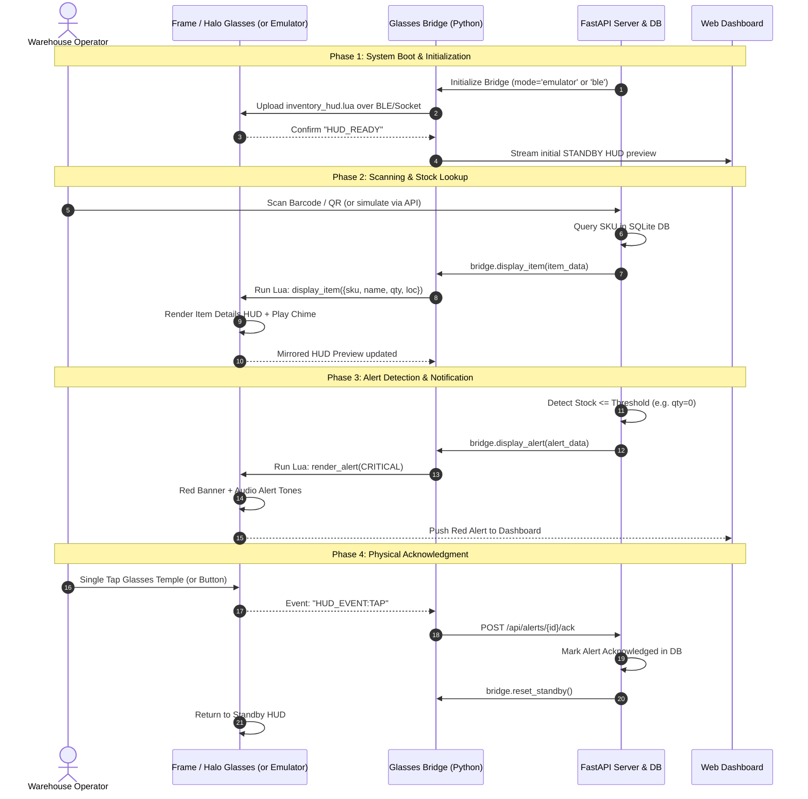

# Brilliant Labs Frame & Halo: Complete Hardware, Firmware & Project Guide

> **Master System Architecture & Developer Playbook**  
> *Uniting Optical AR Hardware, Embedded Firmware, On-Device Lua Scripts, and the Smart Inventory Management System.*

---

## 1. Executive System Overview

The Brilliant Labs AR ecosystem combines open-source hardware, low-power embedded silicon, real-time operating systems, and a Lua scripting runtime. 

This guide connects all three project pillars:
1. **Hardware**: 3D printable mechanical frames, Micro-OLED / OLEDoS optical engines, custom schematics, power subsystems, and camera/sensor modules.
2. **Firmware**: Zephyr RTOS on Halo (Alif Balletto B1), Nordic nRF52840 C firmware + Lattice CrossLink-NX FPGA RTL on Frame, and on-device Lua VMs.
3. **The Project**: A full-stack **Smart Inventory Management & Alert System** that runs on a Python host backend, communicates over Bluetooth Low Energy (or local emulator), and renders a real-time heads-up display (HUD) with tactile and audio feedback.

```mermaid
flowchart TD
    subgraph HardwareLayer["1. Physical Hardware Layer"]
        Optics["Micro-OLED / OLEDoS Optical Engine\n(Frame: 640x400 Sony | Halo: 256x256 Round Guozhao)"]
        MCU["Silicon Core\n(Halo: Alif Balletto B1 Arm M55+NPU\nFrame: nRF52840 + Lattice FPGA)"]
        Sensors["Peripherals & Audio\n(640x480 Camera, IMU Tap, Bone-Conduction Speaker, Buttons)"]
        Power["Power & Mechanics\n(300mAh Li-Po, Mister Power Cradle, 3D CAD Frame)"]
    end

    subgraph FirmwareLayer["2. Embedded Firmware Layer"]
        OS["RTOS Kernel\n(Halo: Zephyr OS | Frame: Nordic Bare-Metal/FreeRTOS)"]
        FPGARTL["FPGA RTL Accelerator\n(Lattice CrossLink-NX Graphics & Camera ISP Pipeline)"]
        LuaVM["Embedded Lua 5.4 Virtual Machine\n(frame.display, frame.camera, frame.sound, frame.imu, frame.button)"]
        BLEStack["BLE Protocol Stack & OTA\n(Nordic DFU / Alif MCUboot SMP Service)"]
    end

    subgraph ProjectLayer["3. Application & Host Project Layer"]
        Bridge["Glasses Bridge (glasses_bridge.py)\n- BLE Mode (brilliant_ble / frame_ble)\n- Emulator Mode (halo_emulator / local)"]
        Backend["Host Application (FastAPI main.py)\n- REST API & WebSockets\n- Inventory Alert Engine (db.py)\n- QR/Barcode Scanner Engine (scanner_service.py)"]
        HUD["On-Device HUD App (inventory_hud.lua)\n- Dynamic State Rendering\n- Audio Tone Generation\n- Physical Tap / Button Event Handling"]
        WebDash["Operator Dashboard & Web Simulator\n(HTML5, Bootstrap 5 Dark, Live HUD Mirroring)"]
    end

    HardwareLayer <--> FirmwareLayer
    FirmwareLayer <-->|Bluetooth Low Energy (GATT RX/TX)| Bridge
    Bridge <--> Backend
    Backend <--> WebDash
    Bridge -.->|Pushes Lua Script & States| LuaVM
    LuaVM -.->|Controls Pixels & Audio| Optics
    Sensors -.->|Tap / Button Events| LuaVM
```

---

## 2. Hardware Architecture & Fabrication

### 2.1 Hardware Comparison Matrix

| Hardware Feature | Brilliant Halo | Brilliant Frame | Brilliant Monocle |
| :--- | :--- | :--- | :--- |
| **Form Factor** | Full Smart Eyewear (Lenses + Arms) | Minimalist Circular Eyewear | Clip-on Single-Eye HUD |
| **Display Panel** | Guozhao VGA020 OLEDoS (0.2") | Sony ECX336 Micro-OLED (0.23") | Micro-OLED 640×400 |
| **Display Resolution**| 256×256 px drawable (round display) | 640×400 px (double-buffered) | 640×400 px |
| **Color Depth** | 24-bit full RGB (`0xRRGGBB` hex) | 16-color named palette | Monochrome / 16 Grayscale |
| **Primary Processor** | Alif Balletto B1 (M55 CPU + U55 NPU) | Nordic Semiconductor nRF52840 | Nordic Semiconductor nRF52832 |
| **Co-Processor** | Arm Ethos-U55 NPU (embedded ML) | Lattice CrossLink-NX FPGA | Gowin GW1N-LV9MG100C6/I5 FPGA |
| **Camera Sensor** | PixArt PAG7982J1 VGA Color Global | OmniVision OV9734 720p Sensor | OmniVision OV5640 5MP Sensor |
| **Audio** | Stereo bone conduction + Stereo MEMS | Single MEMS mic (no speaker) | Single MEMS mic (no speaker) |
| **Input Triggers** | Physical Temple Button + 3-Axis IMU | 3-Axis Accelerometer (Tap only) | Dual Capacitive Touch Pads |
| **Battery Capacity**| 300 mAh (2× 150 mAh in arms) | 180 mAh total (split in arms) | 70 mAh (internal) + 450 mAh case |
| **Charging** | Magnetic pogo-pin dock | "Mister Power" nose bridge cradle | USB-C Clamping Case |

---

### 2.2 Mechanical CAD & 3D Printing

All mechanical assets are located in the local [`hardware/`](hardware/) directory:

- **Halo CAD**: [`hardware/halo/halo.stl`](hardware/halo/halo.stl) — Contains the full front frame, both temple arms (in open position), and lens holders.
- **Frame CAD**:
  - Main Chassis: [`hardware/frame/frame.stl`](hardware/frame/frame.stl)
  - Charging Cradle: [`hardware/frame/charging-cradle.stl`](hardware/frame/charging-cradle.stl) ("Mister Power" nose-clamp dock)
  - Prescription Adapter: [`hardware/frame/frame-rx-clip.stl`](hardware/frame/frame-rx-clip.stl) (snap-in corrective lens clip)
- **Monocle CAD**: [`hardware/monocle/monocle-body.step`](hardware/monocle/monocle-body.step) and [`hardware/monocle/monocle-body.stl`](hardware/monocle/monocle-body.stl)

#### 3D Printing Recommendations:
1. **Material Selection**: Use **SLA / DLP Resin** (Tough Grey or Black) or **HP Multi Jet Fusion (MJF) Nylon PA12**. Avoid standard FDM (filament) for optical frame pieces due to the tight tolerance needed for the prism optical waveguide and snap-fit hinges.
2. **Layer Height**: 0.05 mm (50 microns) for SLA; 0.08 mm for MJF.
3. **Curing & Post-Processing**: Remove support material around the nose bridge and temple flex-PCB channels carefully to avoid damaging the internal routing channels.

---

### 2.3 Electrical Schematics & Power Management

Detailed circuit diagrams are stored in the repository:
- Frame Mainboard Schematics: [`hardware/frame/frame-schematics.pdf`](hardware/frame/frame-schematics.pdf)
- Mister Power Charging Cradle Schematics: [`hardware/frame/charging-cradle-schematics.pdf`](hardware/frame/charging-cradle-schematics.pdf)
- Monocle Core Schematics: [`hardware/monocle/monocle-schematics.pdf`](hardware/monocle/monocle-schematics.pdf)

#### Key Circuit Subsystems:
1. **Li-ion Charging Circuit**: Low-power linear charge controller with reverse-polarity protection and over-voltage cutoff.
2. **Display Power Rail**: Boost converter delivering the necessary 10V–12V OLED cathode rail, switchable via GPIO to achieve near-zero quiescent current during deep sleep.
3. **Power States in Firmware**:
   - `frame.sleep()`: Puts the processor into deep sleep; wakes via IMU tap or BLE advertisement trigger.
   - `frame.light_sleep()` (Halo): Keeps display memory intact while throttling the CPU to 32 kHz.
   - `frame.ship_mode()`: Completely disconnects the battery through the power PMIC for storage.

---

## 3. Firmware Architecture & Build Systems

The glasses run an embedded firmware stack that exposes all hardware peripherals to an onboard **Lua Virtual Machine**.

### 3.1 Halo Firmware (`firmware/halo-firmware/`)
- **OS**: Zephyr RTOS (v3.5+).
- **Target Silicon**: Alif Semiconductor Balletto B1 (Dual-core Cortex-M55 + Ethos-U55 NPU).
- **Lua Engine**: Embedded Lua 5.4 compiled with a minimal standard library (no disk `io`/`os`, replaced by persistent flash table storage).
- **Firmware Update Mechanism**: Over-the-air (OTA) updates using **MCUboot** and the Bluetooth SMP (Simple Management Protocol) service.
- **Source Code**: Located in [`firmware/halo-firmware/`](firmware/halo-firmware/).

#### How to Build Halo Firmware:
```bash
# In an initialized Zephyr workspace:
cd firmware/halo-firmware
west init -l .
west update
west build -b alif_balletto_b1 app
```

---

### 3.2 Frame Firmware & FPGA RTL (`firmware/frame-codebase/`)
- **MCU Subsystem**: Nordic Semiconductor nRF52840 running C firmware for BLE communication, power sequencing, and Lua bytecode execution.
- **FPGA Subsystem**: Lattice CrossLink-NX FPGA.
  - **Graphics Accelerator**: Implements hardware sprite rendering, double-buffering, and gamma color correction.
  - **Camera ISP**: Captures raw camera bytes from the OmniVision OV9734, debayers the image, performs auto-exposure, and streams JPEG slices to the MCU over SPI.
- **Source Code**: Located in [`firmware/frame-codebase/`](firmware/frame-codebase/).

#### How to Build Frame Firmware:
```bash
# 1. Compile Nordic nRF52840 MCU Firmware
cd firmware/frame-codebase
make -C source/mcu

# 2. Synthesize FPGA RTL (Requires Lattice Radiant)
radiantc source/fpga/frame_fpga.tcl
```

---

## 4. The Project: Simple Inventory Management & Alert System

The inventory application is organized into a clean client-bridge-server architecture:

```
inventory_app/
├── main.py               # FastAPI web server, REST endpoints, and lifespan setup
├── db.py                 # SQLite database engine, inventory models, threshold alerts
├── glasses_bridge.py     # BLE and Emulator driver for Frame & Halo devices
├── scanner_service.py    # QR/Barcode image generator and scanning engine
├── cli.py                # Command-line operator interface
├── lua/
│   └── inventory_hud.lua # Embedded Lua application executed on the glasses
├── templates/
│   └── index.html        # Interactive Bootstrap 5 dark-mode dashboard
├── static/
│   ├── current_hud.png   # Real-time mirrored HUD image preview
│   └── barcodes/         # Auto-generated QR codes for all inventory items
└── tests/
    └── test_inventory.py # Automated unit test suite (DB, Alerts, Bridge)
```

### 4.1 On-Device Lua Application (`inventory_hud.lua`)
The on-device script adapts to the connected hardware:
- **Automatic Hardware Detection**:
  ```lua
  local is_halo = (frame.HARDWARE_VERSION == "halo")
  ```
- **Display Output**:
  - Halo (256×256 round): Direct immediate draw calls with 24-bit hex colors (`0xFFCC00`, `0x22DD44`, `0xFF2222`).
  - Frame (640×400 double-buffered): Uses named palette colors (`'YELLOW'`, `'GREEN'`, `'RED'`) and commits frames via `frame.display.show()`.
- **Audio Signaling**:
  - Halo: Uses `frame.sound(freq, duration_ms)` to produce distinctive two-tone alerts for low/out-of-stock items and pleasant confirmation chimes for successful scans.
- **Physical Interaction**:
  - Tap detection via accelerometer callback:
    ```lua
    frame.imu.tap_callback(function() print("HUD_EVENT:TAP") end)
    ```
  - Temple button clicks (Halo):
    ```lua
    frame.button.single = function() print("HUD_EVENT:BUTTON_SINGLE") end
    frame.button.double = function() print("HUD_EVENT:BUTTON_DOUBLE") end
    ```

---

### 4.2 Host Glasses Bridge (`glasses_bridge.py`)
Provides transparent hardware abstraction:
- **Emulator Mode**: Uses `halo_emulator` (built with `pygame-ce` and `lupa`) to run the actual Lua code in a local simulated environment without requiring physical glasses.
- **BLE Mode**: Connects directly to physical Frame or Halo glasses over Bluetooth Low Energy using Nordic UART / Brilliant GATT characteristics to send Lua commands and receive events.
- **HUD Preview Renderer**: Generates a live composite PNG preview (`inventory_app/static/current_hud.png`) mirrored in the web dashboard.

---

### 4.3 Database & Alert Engine (`db.py`)
- Manages inventory records: SKU, item name, current quantity, minimum threshold, aisle/shelf location, and unit price.
- **Automatic Alert Trigger**:
  - `OUT_OF_STOCK`: Fired when `quantity == 0` (Critical priority).
  - `LOW_STOCK`: Fired when `0 < quantity <= min_threshold` (Warning priority).
- **Transaction History**: Logs all check-ins, check-outs, and alert acknowledgments.

---

## 5. End-to-End Developer Workflow: How to Work the Project Out

Follow this step-by-step workflow to develop, test, and operate the complete system.



---

### Step 1: Environment Setup
Ensure you are using the virtual environment configured in the project:

```powershell
# Navigate to project root
cd "C:\Users\Kalpit\Downloads\Brilliant Labs Frame and Halo Development"

# Verify virtual environment Python
.\.venv\Scripts\python.exe --version
# Output: Python 3.14.6
```

---

### Step 2: Run Automated Unit Tests
Verify database transactions, alert rules, and emulator bridge initialization:

```powershell
.\.venv\Scripts\python.exe inventory_app\tests\test_inventory.py
```
*Expected Output:*
```text
Ran 3 tests in 0.466s
OK
```

---

### Step 3: Start the FastAPI Host Server
Launch the backend server with live reload:

```powershell
.\.venv\Scripts\python.exe inventory_app\main.py
```
*The server will start at:* **`http://127.0.0.1:8000`**

Open this address in any browser to access the **Interactive Web Simulator & Dashboard**.

---

### Step 4: Test Operations with the CLI
While the server is running (or standalone), open a second PowerShell terminal to execute real-time operations:

```powershell
# 1. View all inventory items and active alerts
.\.venv\Scripts\python.exe inventory_app\cli.py list

# 2. View active system alerts
.\.venv\Scripts\python.exe inventory_app\cli.py alerts

# 3. Simulate scanning an item (e.g. Frame Smart Glasses)
.\.venv\Scripts\python.exe inventory_app\cli.py scan FRM-BLK-001

# 4. Check out stock to trigger a LOW STOCK alert
.\.venv\Scripts\python.exe inventory_app\cli.py adjust FRM-BLK-001 -8

# 5. Check out all stock to trigger an OUT OF STOCK critical alert
.\.venv\Scripts\python.exe inventory_app\cli.py adjust OLED-SONY-01 0

# 6. Run an automated end-to-end interactive simulation demo
.\.venv\Scripts\python.exe inventory_app\cli.py demo
```

---

### Step 5: Transition from Emulator to Physical Glasses
When your physical Brilliant Labs glasses arrive:

1. **Power on the glasses** and place them within Bluetooth range (1–3 meters).
2. **Switch connection mode** in the Web Dashboard settings or via the REST API:
   ```powershell
   # Switch to physical Halo over BLE
   Invoke-RestMethod -Uri "http://127.0.0.1:8000/api/glasses/config" -Method POST -Body (@{device_type="halo"; mode="ble"} | ConvertTo-Json) -ContentType "application/json"
   
   # Or switch to physical Frame over BLE
   Invoke-RestMethod -Uri "http://127.0.0.1:8000/api/glasses/config" -Method POST -Body (@{device_type="frame"; mode="ble"} | ConvertTo-Json) -ContentType "application/json"
   ```
3. The bridge will scan for BLE advertisements with UUID `0000FEF5` (Nordic) or Halo device names, pair automatically, and upload `inventory_hud.lua` directly into RAM.

---

## 6. Troubleshooting & Diagnostics

| Symptom | Cause | Solution |
| :--- | :--- | :--- |
| `FastAPI Form data requires python-multipart` | Missing multipart parser package | Run `.\.venv\Scripts\python.exe -m pip install python-multipart`. |
| `BLE connection timeout / device not found` | Bluetooth adapter disabled or glasses in sleep mode | Ensure PC Bluetooth is ON. Tap glasses nose bridge or place in charging cradle to wake up. |
| `Lua memory limit exceeded on glasses` | Large string buffers or leaks in Lua runtime | Keep HUD scripts compact; avoid global string concatenations inside loops; call `collectgarbage()` periodically. |
| `Block diagram SVG appears blank in preview` | Browser SVG rendering edge-case | Click the direct link `images/halo-hardware-block-diagram.drawio.svg` to view in native SVG viewer. |
| `HUD preview image not refreshing` | Browser image caching | The dashboard appends a timestamp query `?t=...` on each AJAX poll to bypass caching automatically. |

---

## 7. Project File & Asset Reference

- **Host Application**: [`inventory_app/main.py`](inventory_app/main.py)
- **On-Device HUD**: [`inventory_app/lua/inventory_hud.lua`](inventory_app/lua/inventory_hud.lua)
- **Hardware Files**: [`hardware/`](hardware/)
- **Firmware Sources**: [`firmware/`](firmware/)
- **Documentation**: [`docs/`](docs/)
- **GitHub Repository**: [https://github.com/KalpitRathod/brilliant-labs-frame-halo-development](https://github.com/KalpitRathod/brilliant-labs-frame-halo-development)
