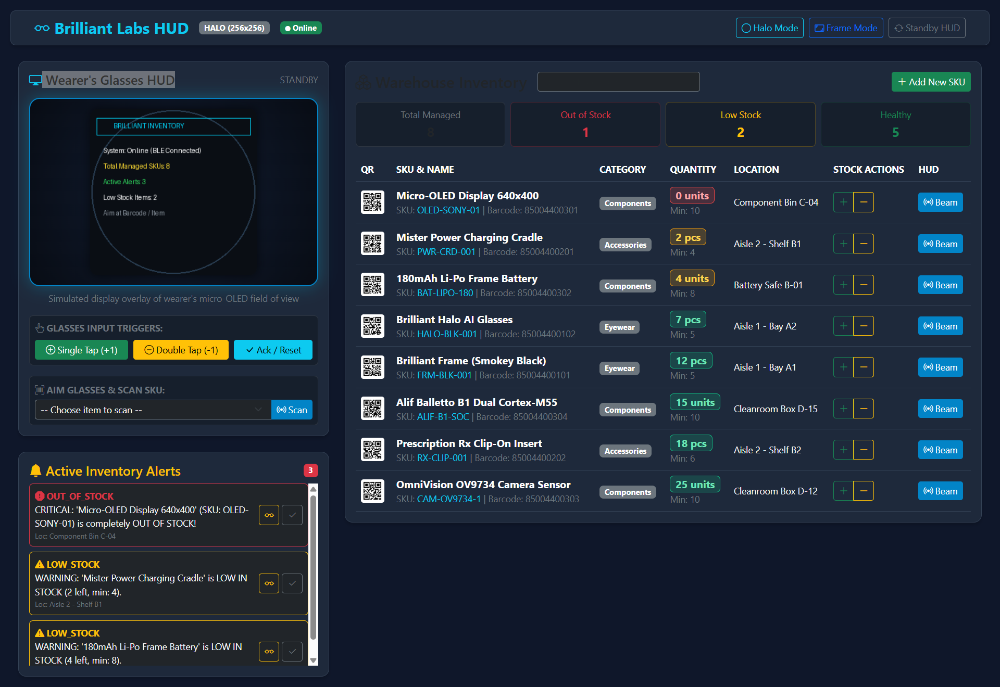

# Brilliant Labs Frame & Halo — Hardware, Firmware & Inventory System

This repository contains the complete hardware CAD models, schematics, firmware codebases, official SDKs, and an end-to-end **Simple Inventory Management & Alert System** for **Brilliant Labs Frame** and **Brilliant Labs Halo** AR glasses.

---

## Web Simulator & Glasses HUD Preview

The system features an interactive real-time Web Simulator & Operations Dashboard. It simulates the wearer's micro-OLED field of view (supporting Halo 256×256 round and Frame 640×400 rectangular formats), displays live inventory stock, and automatically pushes threshold alerts:



---

## Workspace Structure

```
├── hardware/                         # Mechanical 3D CAD (.stl / .step) & Electrical Schematics (.pdf)
│   ├── halo/
│   │   └── halo.stl                  # Halo full 3D assembly (front frame, lenses, temple arms)
│   ├── frame/
│   │   ├── frame.stl                 # Frame 3D CAD model
│   │   ├── charging-cradle.stl       # "Mister Power" charging cradle 3D CAD model
│   │   ├── frame-rx-clip.stl         # Prescription (Rx) clip insert 3D CAD model
│   │   ├── frame-schematics.pdf      # Frame mainboard electrical schematics
│   │   ├── charging-cradle-schematics.pdf # Charging cradle electrical schematics
│   │   ├── frame-mechanical-drawing.pdf
│   │   └── frame-lenses-mechanical-drawing.pdf
│   └── monocle/
│       ├── monocle-body.step         # Monocle STEP 3D CAD model
│       ├── monocle-body.stl          # Monocle STL 3D CAD model
│       ├── monocle-schematics.pdf    # Monocle electrical schematics
│       └── monocle-cc-schematics.pdf # Monocle charging case schematics
│
├── firmware/                         # Official device firmware and FPGA RTL
│   ├── frame-codebase/               # Nordic nRF52840 C firmware + Lattice CrossLink-NX FPGA RTL
│   └── halo-firmware/                # Zephyr RTOS on Alif Balletto B1 (Cortex-M55 + Ethos-U55 NPU)
│
├── sdk/                              # Unified Brilliant SDK (Halo & Frame monorepo)
│   ├── python/                       # brilliant-ble, brilliant-msg, brilliant-sdk, halo-emulator
│   ├── flutter/                      # Melos Flutter workspace for mobile apps
│   └── webbluetooth/                 # WebBluetooth / TypeScript libraries
│
├── apps/
│   └── noa-flutter/                  # Full official Noa companion app source code
│
├── docs/                             # Official documentation portal & API references
│
├── demo_screenshots/                 # Live simulator captures & HUD screenshots
│   └── web_simulator_dashboard.png   # Full web simulator dashboard screenshot
│
├── inventory_app/                    # Smart Glasses Inventory Management & Alert Application
│   ├── db.py                         # SQLite database with threshold alert trigger logic
│   ├── glasses_bridge.py             # BLE & Emulator bridge for Frame & Halo displays
│   ├── scanner_service.py            # Barcode/QR generator & optical camera scanner simulation
│   ├── main.py                       # FastAPI web server & live glasses HUD controller
│   ├── cli.py                        # Terminal CLI for warehouse operators & automated demo
│   ├── lua/
│   │   └── inventory_hud.lua         # On-device Lua HUD app for Frame & Halo
│   ├── static/
│   │   ├── current_hud.png           # Live rendered preview of the wearer's HUD display
│   │   └── barcodes/                 # Printable QR / Barcode labels for inventory SKUs
│   ├── templates/
│   │   └── index.html                # Modern web dashboard with live HUD viewport
│   └── tests/
│       └── test_inventory.py         # Automated unit test suite
│
└── .venv/                            # Configured Python virtual environment
```

---

## Quick Start: Running the Inventory & Alert System

### 1. Activate Environment
In PowerShell:
```powershell
.\.venv\Scripts\Activate.ps1
```

### 2. Run the Interactive Web Dashboard
```powershell
.\.venv\Scripts\python.exe inventory_app\main.py
```
Open your browser to: **`http://127.0.0.1:8000`**

#### Web Dashboard Features:
- **Live Glasses HUD Viewport**: See exactly what the smart glasses wearer sees on their micro-OLED display in real time (`current_hud.png`).
- **Device Switcher**: Toggle between **Halo** (256×256 round color display) and **Frame** (640×400 rectangular display).
- **Virtual Glasses Input**: Simulate temple button / IMU tap gestures:
  - **Single Tap**: +1 Quantity Check-in or Acknowledge Alert.
  - **Double Tap**: -1 Quantity Check-out.
  - **Long Press**: Reset to Standby HUD.
- **Stock & Threshold Management**: View all managed SKUs, adjust quantities, generate printable QR codes.
- **Active Alert Engine**: Low-stock and out-of-stock items automatically generate critical alerts and can be beamed directly to the wearer's HUD.

---

### 3. Run the Terminal CLI & Automated Demo

#### Run End-to-End Automated Demonstration:
```powershell
.\.venv\Scripts\python.exe inventory_app\cli.py demo
```

#### List Current Inventory:
```powershell
.\.venv\Scripts\python.exe inventory_app\cli.py list
```

#### Scan an Item (Beams to Glasses HUD):
```powershell
.\.venv\Scripts\python.exe inventory_app\cli.py scan HALO-BLK-001
```

#### Adjust Stock:
```powershell
.\.venv\Scripts\python.exe inventory_app\cli.py adjust HALO-BLK-001 -1
```

#### View Active Alerts:
```powershell
.\.venv\Scripts\python.exe inventory_app\cli.py alerts
```

---

## Hardware Reference Summary

| Feature | Brilliant Labs Frame | Brilliant Labs Halo |
| :--- | :--- | :--- |
| **Compute SoC** | Nordic nRF52840 (Cortex-M4F) + Lattice FPGA | Alif Balletto B1 (Dual Cortex-M55 + Ethos-U55 NPU) |
| **OS / Runtime** | Custom C Firmware + Embedded Lua VM | Zephyr RTOS + Embedded Lua 5.4 VM |
| **Display** | 640×400 OLED; Double-buffered (`frame.display.show()` required) | 256×256 circular color OLEDoS; Direct draw |
| **Colors** | 16-color named palette (`WHITE`, `RED`, `GREEN`, `BLUE`, etc.) | Full 24-bit RGB hex (`0xRRGGBB`) |
| **Audio** | Single MEMS microphone | Dual MEMS mics + stereo bone conduction speakers |
| **Camera** | OmniVision OV09734 (cropped JPEG via FPGA) | PixArt global shutter VGA (`libmpix` pipeline) |
| **Inputs** | 3-axis IMU tap callback | Physical temple button + IMU tap callback |
| **CAD Format** | STL (`hardware/frame/`) | STL (`hardware/halo/`) |
| **Schematics** | PDF (`hardware/frame/`) | Block diagrams & spec sheets (`docs/halo/`) |

---

## Running Automated Unit Tests
```powershell
.\.venv\Scripts\python.exe inventory_app\tests\test_inventory.py
```
