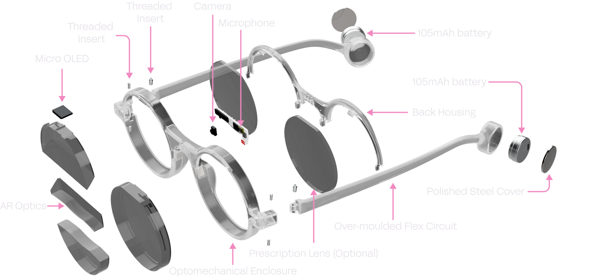
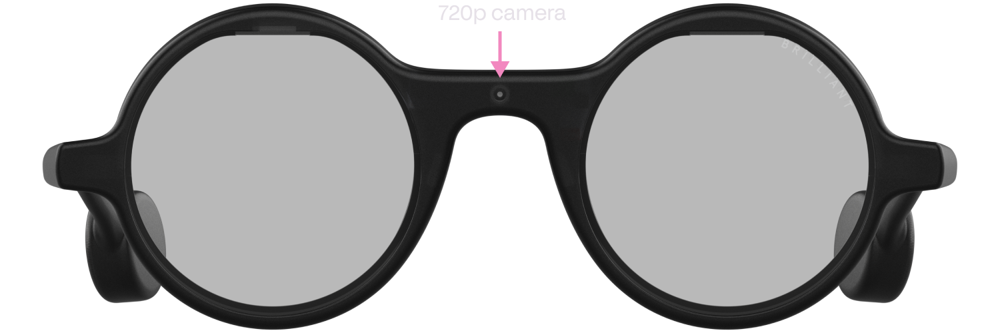
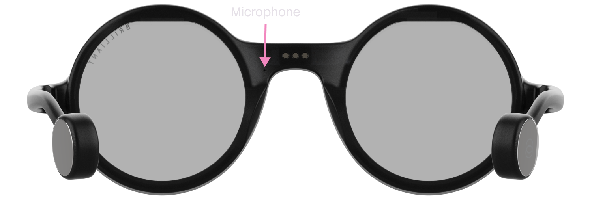
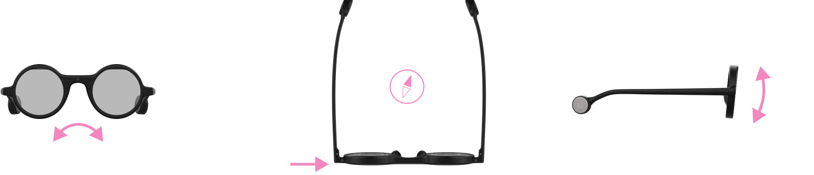
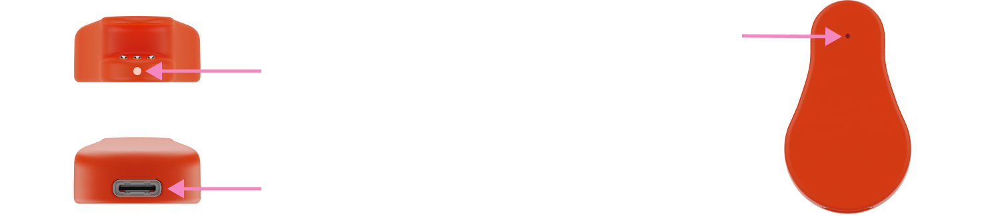

# Frame Hardware Manual

> **Note:** This is an offline copy of the [official Frame Hardware documentation at docs.brilliant.xyz/frame/hardware/](https://docs.brilliant.xyz/frame/hardware/). Links in this file have been updated to work on GitHub.

---

Here you'll find all the details about how Frame works under the hood. For software-related information, check out the [Frame SDK](https://docs.brilliant.xyz/frame/frame-sdk/) including [Lua API](https://docs.brilliant.xyz/frame/frame-sdk-lua/) pages.

---

## Key Features

- 640×400 color OLED display
- 20° FOV optic
- Optional personalized prescriptions
- Thin and light 6 mm lenses (not including optional prescription)
- 720p low power color camera
- Microphone
- FPGA acceleration for graphics and imaging
- Bluetooth 5.3
- 210 mAh built-in rechargeable li-ion battery
- 3-axis accelerometer with tap detection
- 3-axis e-compass
- Full-featured Lua-based OS
- Charging dock with USB Type-C & 140 mAh battery

## Example Uses

- Generative AI on the go
- ML-based image augmentation
- Computer vision research
- QR code & barcode detection
- Heads-up telemetry
- AR app & game design

---

## Table of Contents

- [Hardware Block Diagram](#hardware-block-diagram)
- [Bluetooth MCU](#bluetooth-mcu)
- [FPGA](#fpga)
- [Display](#display)
- [Camera](#camera)
- [Microphone](#microphone)
- [Motion Sensor (IMU)](#motion-sensor-imu)
- [Power](#power)
- [Charging Cradle (Mister Power)](#charging-cradle-mister-power)
- [Schematics](#schematics)
- [Mechanical / 3D CAD](#mechanical--3d-cad)
- [Device Characteristics](#device-characteristics)
- [Safety & Limitation of Liability](#safety--limitation-of-liability)

---

## Hardware Block Diagram

This diagram shows a general overview of the Frame internal hardware architecture.

> **Tip:** GitHub renders SVG files. If the diagram appears blank, [view it directly](images/frame-hardware-block-diagram.drawio.svg) or open it in your browser.

---

## Bluetooth MCU

The Bluetooth MCU serves as the main processor for Frame. It handles all network communication and running of user logic. The MCU used is the [nRF52840](https://www.nordicsemi.com/products/nrf52840) from Nordic Semiconductor. It contains a 32-bit ARM Cortex-M4F CPU running at 64 MHz, 1 MB of flash storage, 256 KB of RAM, and features Bluetooth 5.3 connectivity.

As standard, Frame comes with a feature-rich Lua-based OS that allows for scripting and remote access fully over Bluetooth. No programming cables or proprietary software is needed.

The firmware is fully updatable over the air (OTA). See the [Frame SDK Bluetooth Specs](https://docs.brilliant.xyz/frame/frame-sdk-bluetooth-specs/#firmware-updates) page to implement firmware update capability into your own apps.

### Customizing the Firmware

Frame is intended to be used with the officially provided firmware from Brilliant, however custom firmware is possible. Note this requires destructive disassembly to access the physical debug port.

- **Frame Firmware + FPGA RTL Source:** [firmware/frame-codebase/](../../../firmware/frame-codebase/)
- **Upstream GitHub:** [github.com/brilliantlabsAR/frame-codebase](https://github.com/brilliantlabsAR/frame-codebase)

The physical debug port of the Bluetooth MCU is on the back of the Frame PCB. Five wires connect to an ARM SWD debugger such as a [J-Link probe](https://www.segger.com/products/debug-probes/j-link/) or [Black-Magic probe](https://black-magic.org).

---

## FPGA

The FPGA provides graphics acceleration for the display and interfaces to the 720p camera sensor. It communicates with the Bluetooth MCU via SPI and is dynamically shut down to save power.

The FPGA used is the [CrossLink-NX LIFCL-17](https://www.latticesemi.com/Products/FPGAandCPLD/CrossLink-NX) from Lattice Semiconductor. It features 17k logic cells, 432 KB of embedded block RAM, and 2.56 MB of large RAM.

- **FPGA RTL Source:** [firmware/frame-codebase/source/fpga/](../../../firmware/frame-codebase/source/fpga/)
- **Upstream FPGA section:** [github.com/brilliantlabsAR/frame-codebase/tree/main/source/fpga](https://github.com/brilliantlabsAR/frame-codebase/tree/main/source/fpga)

The FPGA does not expose a physical programming interface — the FPGA application is uploaded solely via SPI at boot.

---

## Display

The display used in Frame is a 0.23" micro-OLED featuring **640×400 RGB pixels**, optically bonded to a prism assembly that directs the image into the user's eye. The result is a transparent floating display with a **20° field of view**, appearing about the size of a tablet at arm's length.

The display is connected to the FPGA in 8-bit YCbCr mode (4 wires Y, 2 wires Cb, 2 wires Cr), allowing up to 255 possible colors. The FPGA RTL is optimized to display a maximum of **16 colors per frame** (changeable on the fly), enabling large sprite sets and fonts within embedded memory.

Unlike Halo, Frame uses **double-buffering** — you must call `frame.display.show()` to push drawn content to the screen.

**Lua display API reference:** [docs.brilliant.xyz/frame/frame-sdk-lua/#display](https://docs.brilliant.xyz/frame/frame-sdk-lua/#display)

---

## Camera

The front-facing camera on Frame is the [OV09734](https://www.ovt.com/products/ov09734-h16a-2a/) from OmniVision — an incredibly small and power-efficient sensor.

The FPGA RTL optimizes images for AI applications such as image recognition, with large control over resolution, gain, and exposure. Images are captured as 1280×720 RGB, cropped to **720×720**, and converted to YCbCr for memory efficiency and fast BLE download.

**Lua camera API reference:** [docs.brilliant.xyz/frame/frame-sdk-lua/#camera](https://docs.brilliant.xyz/frame/frame-sdk-lua/#camera)

---

## Microphone

Frame features a single [ICS-41351](https://product.tdk.com/system/files/dam/doc/product/sw_piezo/mic/mems-mic/data_sheet/ds-000157-ics-41351-v1.4.pdf) MEMS microphone from TDK. It has a wide dynamic range from -35.5 dB to 129.5 dB, allowing it to hear everything from soft speech to loud booming sounds.

The microphone is connected directly to the Bluetooth MCU for low-power operation and wake detection. The standard firmware allows recording formats from 4-bit to 16-bit sample depth and 4 kHz to 20 kHz sample rate.

**Lua microphone API reference:** [docs.brilliant.xyz/frame/frame-sdk-lua/#microphone](https://docs.brilliant.xyz/frame/frame-sdk-lua/#microphone)

---

## Motion Sensor (IMU)

The IMU on Frame is the 6-axis [MC6470](https://eu.mouser.com/datasheet/2/821/MC6470_Datasheet_APS_048_0033v1_7_1-3003085.pdf) from MEMSIC, featuring both an accelerometer and e-compass in a tiny low-power package. The Bluetooth MCU calculates raw X, Y, Z values into angular values for detecting head position.

An accelerometer interrupt line is directly connected to the Bluetooth MCU for always-on tap detection to navigate and select UI elements.

**Lua IMU/tap API reference:** [docs.brilliant.xyz/frame/frame-sdk-lua/#imu](https://docs.brilliant.xyz/frame/frame-sdk-lua/#imu)

---

## Power

Power is internally distributed via the [MAX77654](https://www.analog.com/media/en/technical-documentation/data-sheets/max77654.pdf) PMIC from Analog Devices. Each rail is carefully managed to protect components and ensure lasting battery performance.

> ⚠️ **Warning:** The PMIC is configured from C code baked into the Bluetooth MCU firmware. If creating custom firmware, avoid changing PMIC settings without carefully studying the schematics and PMIC datasheet — incorrect settings can over-volt components or damage the battery.

### Battery Charging

The PMIC includes an integrated battery charger for the two built-in 105 mAh li-ion cells (210 mAh total). An analog pin provides battery voltage and current monitoring.

---

## Charging Cradle (Mister Power)

The charging cradle charges Frame via the 5V pogo-pin terminal on the back of the glasses, and allows for factory resetting and device un-pairing. It also contains a **140 mAh** rechargeable li-ion cell for top-up charging on the go. The cradle itself charges via any **USB Type-C** power supply.

---

## Schematics

| Schematic | Local File | Description |
| :--- | :--- | :--- |
| **Frame Mainboard** | [hardware/frame/frame-schematics.pdf](../../../hardware/frame/frame-schematics.pdf) | nRF52840 BLE SoC, Lattice FPGA, PMIC (MAX77654), sensors, display driver |
| **Charging Cradle** | [hardware/frame/charging-cradle-schematics.pdf](../../../hardware/frame/charging-cradle-schematics.pdf) | "Mister Power" USB-C dock, pogo-pin interface, 140 mAh supplemental battery |

> 📄 PDF files can be viewed by clicking the links above on GitHub. For inline viewing, use a local PDF reader.

---

## Mechanical / 3D CAD

| Asset | File | Description |
| :--- | :--- | :--- |
| **Frame Body (STL)** | [hardware/frame/frame.stl](../../../hardware/frame/frame.stl) | Full frame geometry for 3D printing or fit checks |
| **Charging Cradle (STL)** | [hardware/frame/charging-cradle.stl](../../../hardware/frame/charging-cradle.stl) | 3D printable "Mister Power" dock |
| **Prescription Rx Clip (STL)** | [hardware/frame/frame-rx-clip.stl](../../../hardware/frame/frame-rx-clip.stl) | Snap-on adapter clip for corrective lenses |
| **Frame Mechanical Drawing** | [hardware/frame/frame-mechanical-drawing.pdf](../../../hardware/frame/frame-mechanical-drawing.pdf) | Dimensioned blueprint — frame, hinge, nose-pad |
| **Lens Mechanical Drawing** | [hardware/frame/frame-lenses-mechanical-drawing.pdf](../../../hardware/frame/frame-lenses-mechanical-drawing.pdf) | Optical cut-out dimensions, prism alignment, lens curve radius |

**Recommended 3D printing materials:**
- **Frame & temple arms:** SLS/MJF — Nylon PA12
- **Rx clip:** SLA/DLP — Tough Resin or ABS-like, 50 µm layer height
- **Charging cradle:** FDM — PETG or PLA+, 0.16–0.20 mm layer height

---

## Device Characteristics

Typical and absolute device characteristics are shown below.

### Typical Characteristics

| | Min | Typ | Max |
|:---|:---:|:---:|:---:|
| Frame operating current | 45 mA | 80 mA | 100 mA |
| Frame sleep current | — | 580 µA | — |
| Frame shutdown current | — | 132 µA | — |
| Frame charging current | 1.5 mA | — | 225 mA |
| Charging cradle current | — | — | 400 mA |
| Bluetooth radio power | -20 dBm | — | 8 dBm |
| Bluetooth sensitivity | — | — | -95 dBm |

### Maximum Ratings

| | Min | Typ | Max |
|:---|:---:|:---:|:---:|
| Frame charging voltage | -0.3 V | 5.1 V | 6.4 V |
| Charging cradle USB voltage | -0.3 V | 5.1 V | 7 V |
| Operating temperature | 0°C | — | 45°C |
| Storage temperature | -20°C | — | 60°C |

---

## Safety & Limitation of Liability

### Safety

Brilliant Labs' devices can obscure your vision and should not be used while driving or operating dangerous equipment. Long periods of use may cause eye strain, headaches, and motion sickness. Devices can display bright flashing images and may not be suitable for those susceptible to photosensitivity.

### Critical Applications

Brilliant Labs' devices are intended for consumer and R&D applications only. Not verified for use where performance and accuracy would be critical to human health, safety, or mission-critical use.

### Lithium Batteries

Lithium batteries can be dangerous if mishandled. Do not expose devices to excess temperatures, fire, or liquids. Do not remove the battery. Dispose safely at e-waste collection points.

### FCC Notice

This device complies with part 15 of the FCC Rules: (1) This device may not cause harmful interference, and (2) this device must accept any interference received, including interference that may cause undesired operation.

The device has been evaluated to meet general RF exposure requirements and can be used in portable exposure conditions without restriction.

### Limitation of Liability

Brilliant Labs provides technical data, resources, and tools "as is" and disclaims all warranties, express and implied. These resources are intended for skilled developers. You are solely responsible for selecting appropriate products, designing, validating, and testing your application.

Brilliant Labs reserves the right to change the circuitry and specifications without notice. The parametric values quoted in this manual are provided for guidance only.

Resources and products are provided subject to the [Brilliant Labs terms and conditions](https://brilliant.xyz/pages/terms-conditions).
