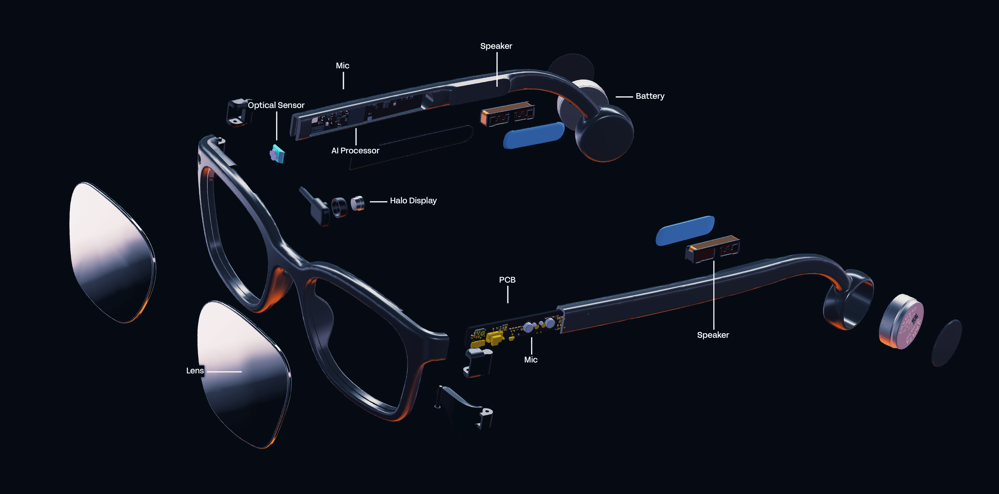
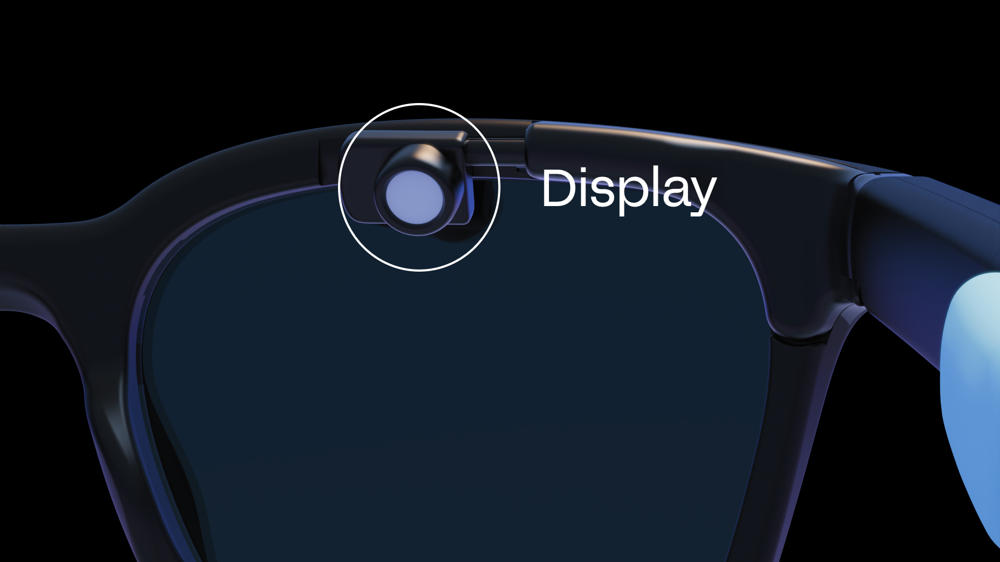
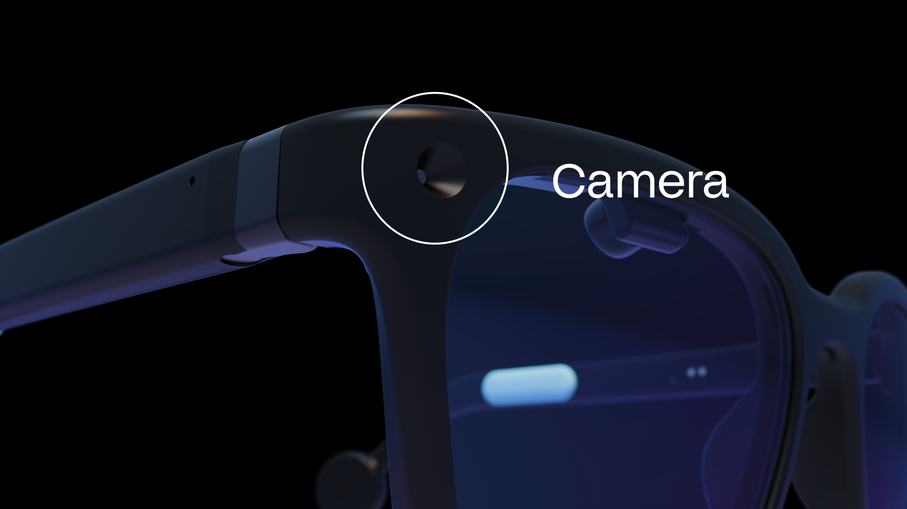
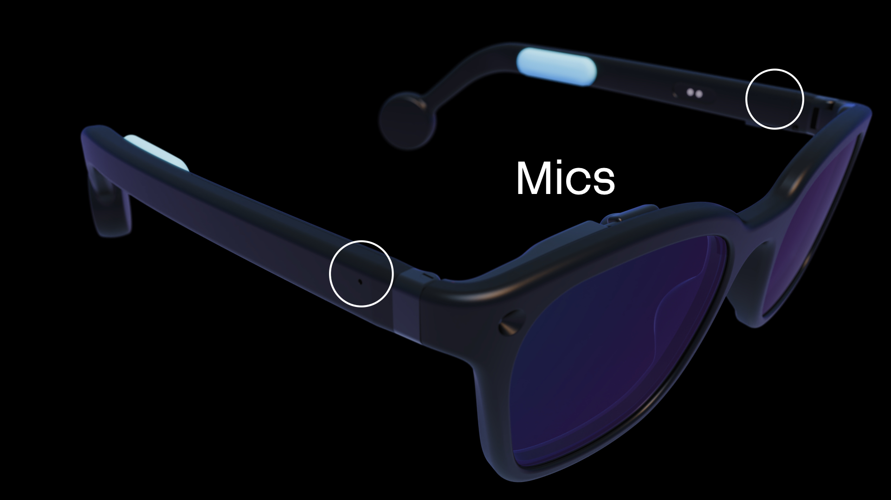
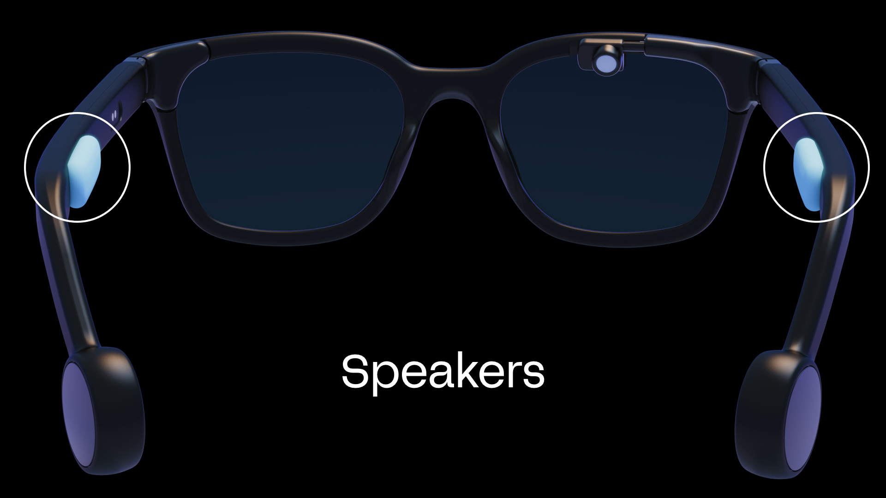
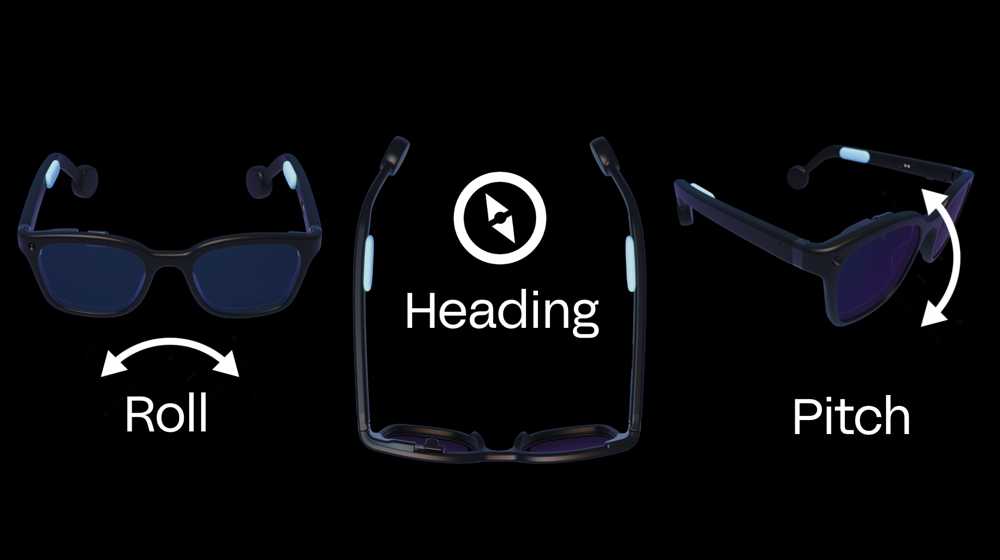
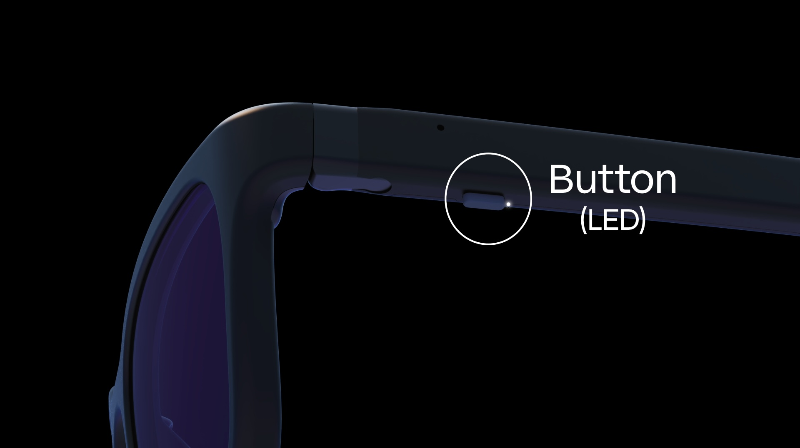
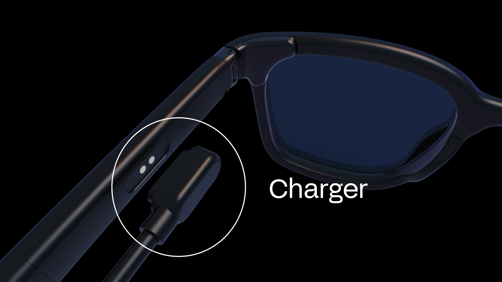

# Halo Hardware Manual

> **Note:** This is an offline copy of the [official Halo Hardware documentation at docs.brilliant.xyz/halo/hardware/](https://docs.brilliant.xyz/halo/hardware/). Links in this file have been updated to work on GitHub.

---

Here you'll find all the details about how Halo works under the hood. For software-related information, check out the [Brilliant SDK](https://docs.brilliant.xyz/halo/halo-sdk/) including the [Lua API](https://docs.brilliant.xyz/halo/halo-sdk-lua/) pages.

---

## Key Features

- 0.2" color OLEDoS micro-display (256×256 px drawable area)
- 640×480 global shutter color camera
- Stereo MEMS microphones
- Stereo bone conduction speakers
- Arm Cortex-M55 CPU + Arm Ethos-U55 NPU
- Bluetooth LE 5.3
- 300 mAh built-in rechargeable li-ion battery (2×150 mAh cells)
- 3-axis accelerometer with tap detection
- 3-axis e-compass
- Full-featured Zephyr OS with Lua VM
- Magnetic charging connector

## Example Uses

- Generative AI on the go
- Heads-up telemetry
- AR app & game design
- Voice interaction
- Computer vision research

---

## Table of Contents

- [Hardware Block Diagram](#hardware-block-diagram)
- [Bluetooth MCU](#bluetooth-mcu)
- [Display](#display)
- [Camera](#camera)
- [Microphones](#microphones)
- [Speakers](#speakers)
- [Motion Sensor (IMU)](#motion-sensor-imu)
- [Button](#button)
- [Power](#power)
- [Mechanical / 3D CAD](#mechanical--3d-cad)
- [Safety & Limitation of Liability](#safety--limitation-of-liability)

---

## Hardware Block Diagram

This diagram shows a general overview of the Halo internal hardware architecture.

> **Tip:** GitHub renders SVG files. If the diagram appears blank, [view it directly](images/halo-hardware-block-diagram.drawio.svg) or open it in a browser.

---

## Bluetooth MCU

The Bluetooth MCU serves as the main processor for Halo. It handles all network communication and running of user logic. The MCU used is the [Balletto B1](https://alifsemi.com/products/family/balletto/) from Alif Semiconductor. It contains a 32-bit Arm Cortex-M55 CPU, Arm Ethos-U55 Neural Processing Unit (NPU), 1.8 MB of MRAM flash storage, 2.0 MB of SRAM, and features Bluetooth LE 5.3 connectivity.

As standard, Halo runs Zephyr OS and a Lua VM that allows for scripting and remote access fully over Bluetooth. No programming cables or proprietary software is needed to use the device.

The firmware is fully updatable over the air (OTA) using MCUboot and BLE. If you're developing your own apps, see the [Halo SDK Bluetooth Specs](https://docs.brilliant.xyz/halo/halo-sdk-bluetooth-specs/#firmware-updates) page to implement firmware update capability.

### Customizing the Firmware

Halo is intended to be used with the officially provided firmware from Brilliant, however it is possible to customize the firmware if desired.

- **Halo Firmware Source (Zephyr RTOS):** [firmware/halo-firmware/](../../../firmware/halo-firmware/)
- **Upstream GitHub:** [github.com/brilliantlabsAR/halo-firmware](https://github.com/brilliantlabsAR/halo-firmware)

---

## Display

The display used in Halo is the full RGB color [VGA020](https://www.gzot.com/en/product_details/22) OLEDoS (OLED on Silicon) micro-display from Guozhao Optoelectronics. It features 640×480 RGB pixels on a 0.2" panel with a 6.3 μm pixel pitch. It delivers full RGB color, a 10000:1 contrast ratio, 256 grayscale levels, up to 5000 nit peak brightness, and a refresh rate of 25–120 Hz. It connects via MIPI (2-lane D-PHY) or Quad SPI.

Unlike Frame, Halo's display has **no double-buffer** — draw calls take effect immediately, and no `show()` call is required. Colors are specified as full 24-bit RGB hex values (`0xRRGGBB`).

**Lua display API reference:** [docs.brilliant.xyz/halo/halo-sdk-lua/#display](https://docs.brilliant.xyz/halo/halo-sdk-lua/#display)

---

## Camera

The front-facing camera on Halo is the [PAG7982J1](https://www.pixart.com/products-detail/163/PAG7982J1) from PixArt Imaging — a compact VGA color camera module with a global shutter. It captures 640×480 images with an 81.2° horizontal field of view, and consumes just 40 mW at full frame rate. The global shutter eliminates rolling shutter artefacts, making it well suited to computer vision applications.

Images are processed using the [libmpix](https://libmpix.org/) pipeline, allowing a configurable camera processing chain.

**Lua camera API reference:** [docs.brilliant.xyz/halo/halo-sdk-lua/#camera](https://docs.brilliant.xyz/halo/halo-sdk-lua/#camera)

---

## Microphones

Halo features dual T5838 MEMS microphones from TDK. It has an exceptionally wide dynamic range with an SNR of 68 dBA and an acoustic overload point of 133 dB SPL. The digital PDM output connects directly to the Bluetooth MCU.

The microphones support multiple power modes — from a 310 µA high-quality mode down to a 20 µA always-on mode for Audio Activity Detection (AAD) wake detection. The standard firmware allows for recording formats including **PCM** and **LC3**, with configurable sample rates.

**Lua microphone API reference:** [docs.brilliant.xyz/halo/halo-sdk-lua/#microphone](https://docs.brilliant.xyz/halo/halo-sdk-lua/#microphone)

---

## Speakers

Halo features stereo bone conduction speakers from Thor Innovation, driven by a [TPA2011D1](https://www.ti.com/product/TPA2011D1) 3.2 W mono Class-D audio power amplifier from Texas Instruments. The TPA2011D1 is a filter-free Class-D amp in a tiny 1.21×1.16 mm DSBGA package, with 95% efficiency, 1.5 mA quiescent current, and auto-recovering short-circuit and thermal overload protection.

Audio data is streamed from the host to Halo over a dedicated Bluetooth `AUDIO TX` characteristic, bypassing the Lua VM for low-latency delivery. Both **PCM** and **LC3** audio formats are supported.

**Lua audio/speaker API reference:** [docs.brilliant.xyz/halo/halo-sdk-lua/#audio](https://docs.brilliant.xyz/halo/halo-sdk-lua/#audio)

---

## Motion Sensor (IMU)

Halo's motion sensing uses two sensors working together:

- **Accelerometer:** [BMA580](https://www.bosch-sensortec.com/products/motion-sensors/accelerometers/bma580/) from Bosch Sensortec — triaxial 16-bit, configurable ±2/4/8/16g range, SPI/I²C/I3C interface, ~125 µA typical. Includes an on-chip interrupt engine with **single, double, and triple tap detection**.
- **E-compass:** [QMC6308](https://www.qst.com.cn/product_detail/id/130.html) from QST — 3-axis magnetometer, ±3 mT range, 16-bit resolution, I²C, consuming just 30 µA.

An accelerometer interrupt line is directly connected to the Bluetooth MCU for always-on tap detection to navigate and select UI elements.

**Lua IMU API reference:** [docs.brilliant.xyz/halo/halo-sdk-lua/#imu](https://docs.brilliant.xyz/halo/halo-sdk-lua/#imu)

---

## Button

Halo has a physical push button placed under the left temple arm for convenient access for power on/off, Bluetooth pairing, and user-programmable functions (single press, double press, long press).

**Default button functions:** [docs.brilliant.xyz/halo/using-halo/#button-controls](https://docs.brilliant.xyz/halo/using-halo/#button-controls)

**Lua button API reference:** [docs.brilliant.xyz/halo/halo-sdk-lua/#button](https://docs.brilliant.xyz/halo/halo-sdk-lua/#button)

---

## Power

### Battery Charging

Halo uses the [BQ25170](https://www.ti.com/product/BQ25170) from Texas Instruments — a dedicated 800 mA linear battery charger for 1-cell Li-Ion, Li-Polymer, and LiFePO₄ batteries. It charges the two built-in [GRP1654M1](https://www.grepow.com/button-cell-battery/grp1654.html) NMC li-ion button cells from Grepow (150 mAh each, **300 mAh total**, 3.7 V nominal). An NTC thermistor monitors battery temperature. The cells are rated for **1000+ charge cycles** and support charging between 0°C and +45°C.

**Lua battery API reference:** [docs.brilliant.xyz/halo/halo-sdk-lua/#battery](https://docs.brilliant.xyz/halo/halo-sdk-lua/#battery)

### Charger

Halo uses a **magnetic connector** for convenient one-step charging over USB Type-C.

---

## Mechanical / 3D CAD

| Asset | File | Description |
| :--- | :--- | :--- |
| **Halo 3D Model (STL)** | [hardware/halo/halo.stl](../../../hardware/halo/halo.stl) | Full assembly — front frame, both lenses, both temple arms in open position |

**Recommended 3D printing materials:**
- **Glasses chassis & temple arms:** SLS/MJF — Nylon PA12 (lightweight, durable, snap-fit flex)
- **Tolerances:** Pogo-pin holes and magnetic alignment pockets modeled with +0.15 mm clearance

---

## Safety & Limitation of Liability

### Safety

Brilliant Labs' devices can obscure your vision and should not be used while driving or operating dangerous equipment. Long periods of use may cause eye strain, headaches, and motion sickness. Brilliant Labs' devices can also display bright flashing images and may not be suitable for those susceptible to photosensitivity.

### Critical Applications

Brilliant Labs' devices are intended for consumer and R&D applications only. They are not verified for use where performance and accuracy would be critical to human health, safety, or mission-critical use.

### Lithium Batteries

Lithium batteries can be dangerous if mishandled. Do not expose Brilliant Labs' devices to excess temperatures, fire, or liquids. Do not attempt to remove the battery. Once the product reaches end of life, dispose of it safely at an e-waste collection point.

### FCC Notice

This device complies with part 15 of the FCC Rules. Operation is subject to the following two conditions: (1) This device may not cause harmful interference, and (2) this device must accept any interference received, including interference that may cause undesired operation.

Any changes or modifications not expressly approved by the party responsible for compliance could void the user's authority to operate the equipment.

The device has been evaluated to meet general RF exposure requirements and can be used in portable exposure conditions without restriction.

### Limitation of Liability

Brilliant Labs provides technical data, including design resources, examples, applications, design advice, tools, safety information, and other resources "as is" and disclaims all warranties, express and implied. These resources are intended for skilled developers. You are solely responsible for selecting appropriate products for your application, designing, validating, and testing your application.

Brilliant Labs reserves the right to change the circuitry and specifications without notice at any time. The parametric values quoted in this manual are provided for guidance only.

Resources and products are provided subject to the [Brilliant Labs terms and conditions](https://brilliant.xyz/pages/terms-conditions).
